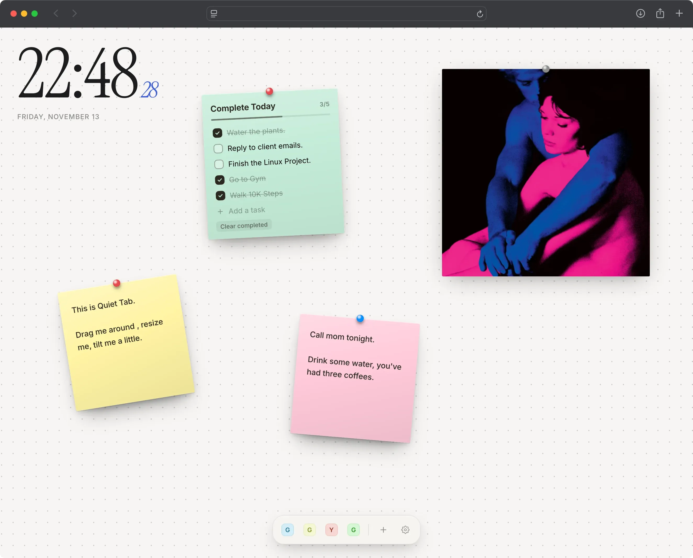
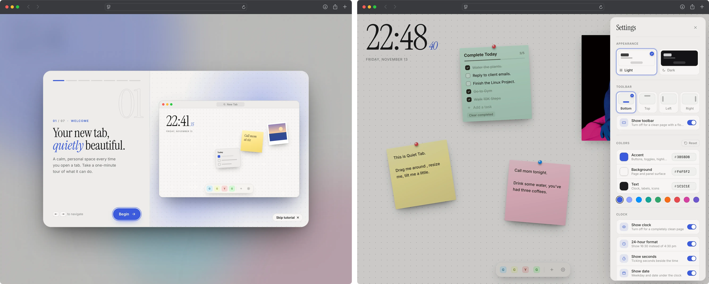

# Quiet Tab

A calm, minimal New Tab page for Chrome.

I wanted a new tab that didn't shout at me, so I made one. You get a big clock, a soft dotted background and a small toolbar with the sites you actually use. If you want more, there's a pinboard for images, sticky notes and to-do lists. If you don't, you can switch almost everything off.



## Why it exists

Most new tab pages are busy. They show news, ads and things you never asked for. Quiet Tab does the opposite. It gives you a clean space to start from, with a few useful tools when you need them.

## Features

- **Clock.** A large, simple clock with 12/24-hour time, seconds, date and size options. You can hide it too.
- **Shortcuts toolbar.** Add your favorite sites from the **+** menu. Place the toolbar on any edge of the screen, or hide it for a fully clean page.
- **Pinboard.** Drop, paste or upload images. Add sticky notes and to-do lists. Drag, resize, rotate and pin them where you like.
- **Easy to-do lists.** Long tasks wrap onto new lines, and you can move between tasks with the arrow keys and Enter.
- **Movable canvas.** Drag empty space to look around. Double-click to jump back.
- **Your own style.** Light or dark mode, custom colors, dots, grid or plain backgrounds, or your own photo with dim and blur.
- **Local saves and backup.** Settings stay in sync across open tabs, and you can export everything to one JSON file.
- **Quick tour.** A short guide shows you around on first run. You can replay it from Settings → Help.

## Built with

- Plain HTML, CSS and JavaScript (no frameworks)
- Chrome Extension Manifest V3
- Bundled fonts: Instrument Serif and Inter

## Getting started

1. Download the latest Quiet Tab ZIP from the [Releases](../../releases) page and unzip it.
2. Open `chrome://extensions` and turn on **Developer mode** (top right).
3. Click **Load unpacked** and select the unzipped folder containing `manifest.json`.
4. Open a new tab. That's it.

Quiet Tab targets Chrome 111 or newer. Other Chromium browsers may support the new-tab override.

**Running from source:** clone this repo and load the `ext` folder with **Load unpacked** instead.

## Using it

- Click **+** to add a shortcut, image, sticky note or to-do list.
- Open **Settings** to change the clock, toolbar, colors and background.
- Double-click a rotate or resize handle to reset it.




## Privacy

Quiet Tab stores your settings and images in your browser profile. It has no accounts or analytics. The page uses bundled assets and Chrome's local favicon cache. Opening a shortcut navigates to the selected site.

The extension only asks for three permissions:

- `storage` to save your settings
- `unlimitedStorage` so your photos fit
- `favicon` to show site icons

## Good to know

- Site icons come from Chrome's own cache. A new shortcut may show a placeholder until you visit the site once.
- Images are resized when you add them. Individual uploads can be up to 64 MiB.
- Backups contain your settings, shortcuts, board and images in a portable JSON file. Importing replaces your saved data after confirmation. Backups can be up to 128 MiB.

## Development

Load `ext/` as an unpacked extension. That folder contains all runtime code and assets. Settings live in `chrome.storage.local`, while images live in IndexedDB. The extension ships with zero third-party JavaScript dependencies.

With Node.js 22+ and Python 3 installed:

```sh
npm ci
npm test
npx playwright-core install chromium
npm run test:browser
npm run package
```

The browser suite opens the real new-tab override in a disposable Chromium profile. To use an installed Chromium executable, set `CHROMIUM_PATH`. Packaging writes `dist/quiet-tab-v<version>.zip` with the manifest at the archive root.

## License

Free to use. See [LICENSE.md](LICENSE.md).
