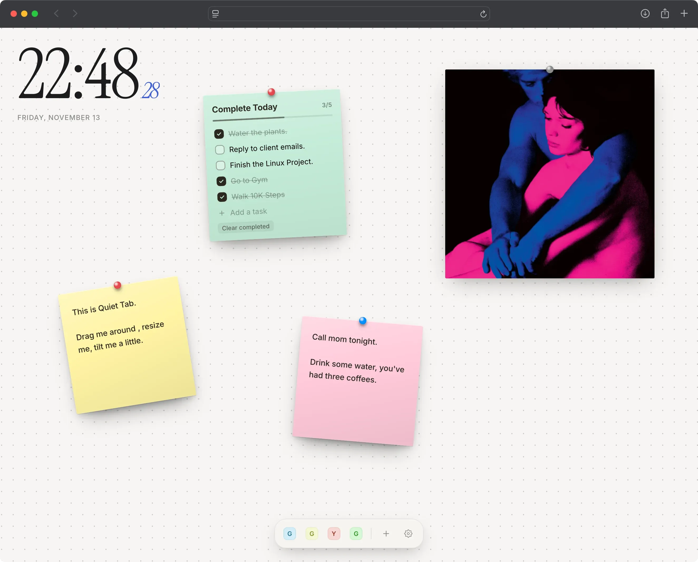
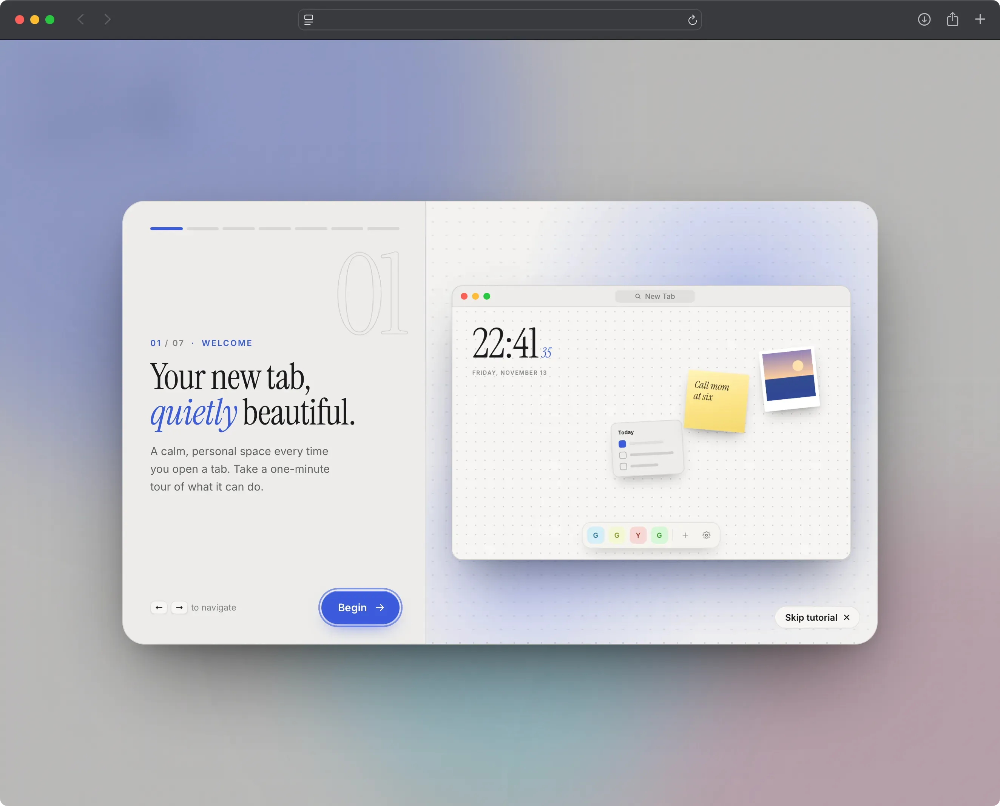
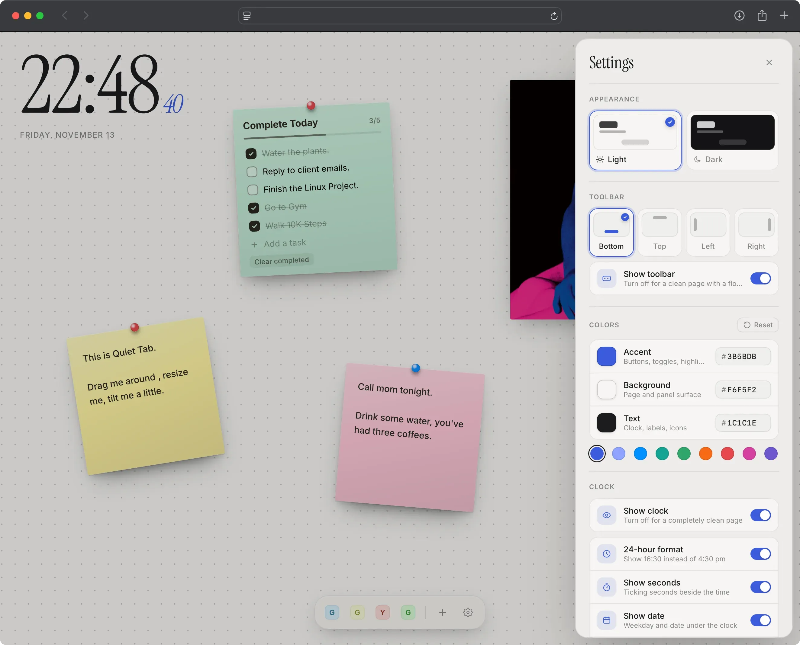

# Quiet Tab

A calm, minimal New Tab page for Chrome.

I wanted a new tab that didn't shout at me, so I made one. You get a big clock, a soft dotted background and a small toolbar with the sites you actually use. If you want more, there's a pinboard for images, sticky notes and to-do lists. If you don't, you can switch almost everything off.



## Why it exists

Most new tab pages are busy. They show news, ads and things you never asked for. Quiet Tab does the opposite. It gives you a clean space to start from, with a few useful tools when you need them.

## Features

- **Clock.** A large, simple clock with 12/24-hour time, seconds, date and size options. You can hide it too.
- **Shortcuts toolbar.** Add your favorite sites from the **+** menu. Place the toolbar on any edge of the screen, or hide it for a fully clean page.
- **Pinboard.** Drop, paste or upload images. Add sticky notes and to-do lists. Drag, resize, rotate and pin them where you like.
- **Easy to-do lists.** Long tasks wrap onto new lines, and you can move between tasks with the arrow keys and Enter.
- **Movable canvas.** Drag empty space to look around. Double-click to jump back.
- **Your own style.** Light or dark mode, custom colors, dots, grid or plain backgrounds, or your own photo with dim and blur.
- **Sync and backup.** Settings stay in sync across open tabs, and you can export everything to one JSON file.
- **Quick tour.** A short guide shows you around on first run. You can replay it from Settings → Help.

## Built with

- Plain HTML, CSS and JavaScript (no frameworks)
- Chrome Extension Manifest V3
- Bundled fonts: Instrument Serif and Inter

## Getting started

1. Download `quiet-tab-v1.0.0.zip` from the [Releases](../../releases) page and unzip it.
2. Open `chrome://extensions` and turn on **Developer mode** (top right).
3. Click **Load unpacked** and select the `quiet-tab-v1.0.0` folder.
4. Open a new tab. That's it.

You need Chrome 111 or newer. It should also work in Edge, Brave and Arc.

**Running from source:** clone this repo and load the `ext` folder with **Load unpacked** instead.

## Using it

- Click **+** to add a shortcut, image, sticky note or to-do list.
- Open **Settings** to change the clock, toolbar, colors and background.
- Double-click a rotate or resize handle to reset it.





## Privacy

Nothing leaves your computer. There are no accounts, no analytics and no network requests. Your settings and images are stored locally in your browser.

The extension only asks for three permissions:

- `storage` to save your settings
- `unlimitedStorage` so your photos fit
- `favicon` to show site icons

## Good to know

- Site icons come from Chrome's own cache. A new shortcut may show a placeholder until you visit the site once.
- Images are resized when you add them, to keep things light.

## Project structure

```
ext/           The extension (manifest, HTML, CSS, JS, fonts, icons)
screenshots/   Images used in this README
```

## License

Free to use. See [LICENSE.md](LICENSE.md).
